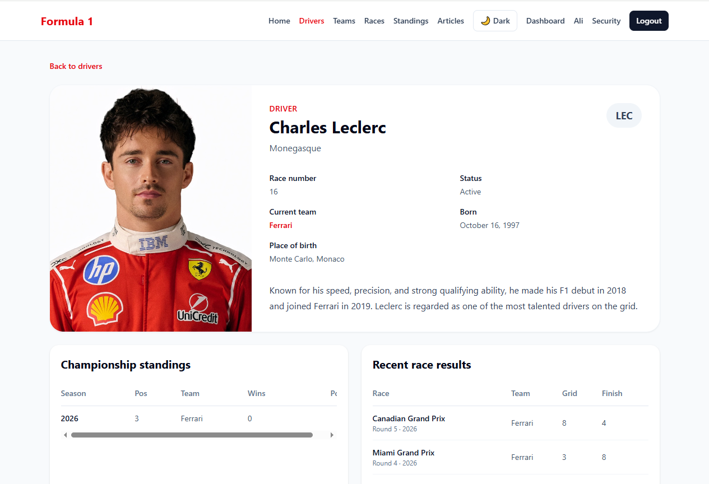
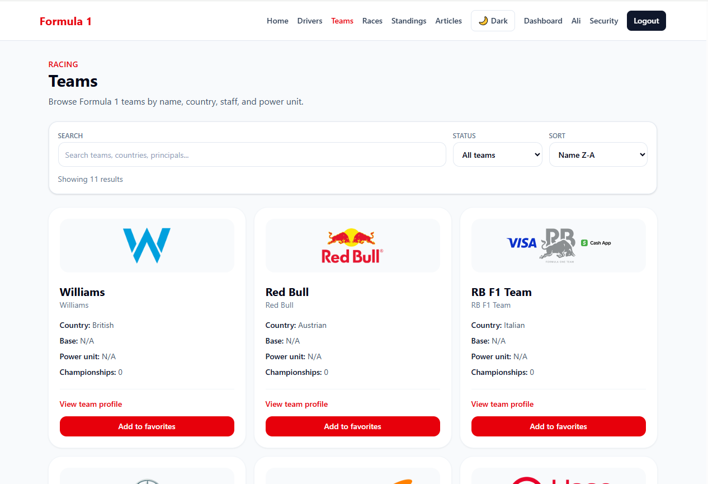
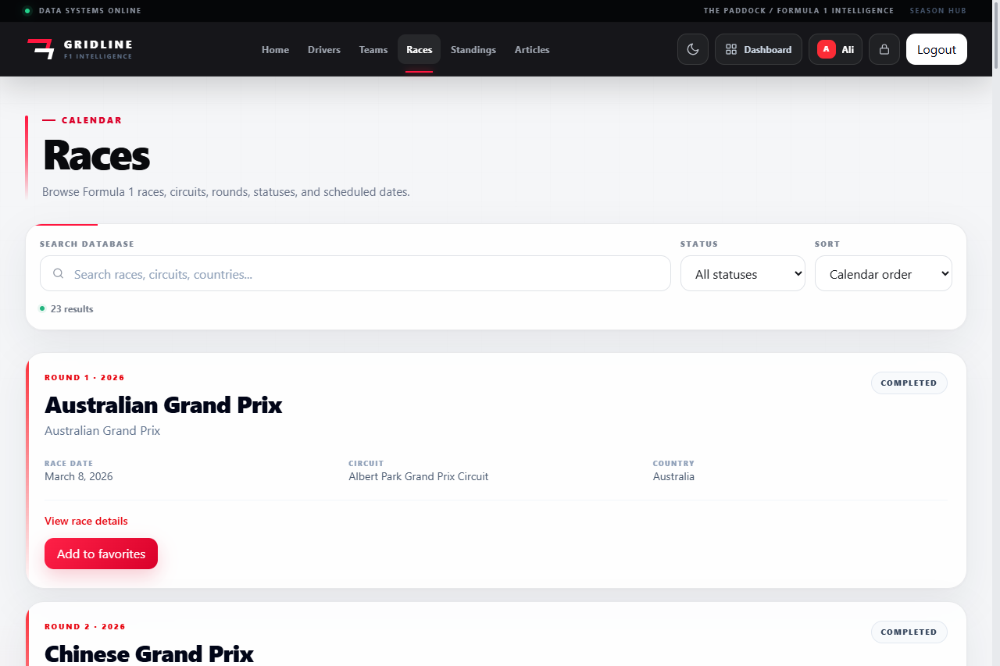
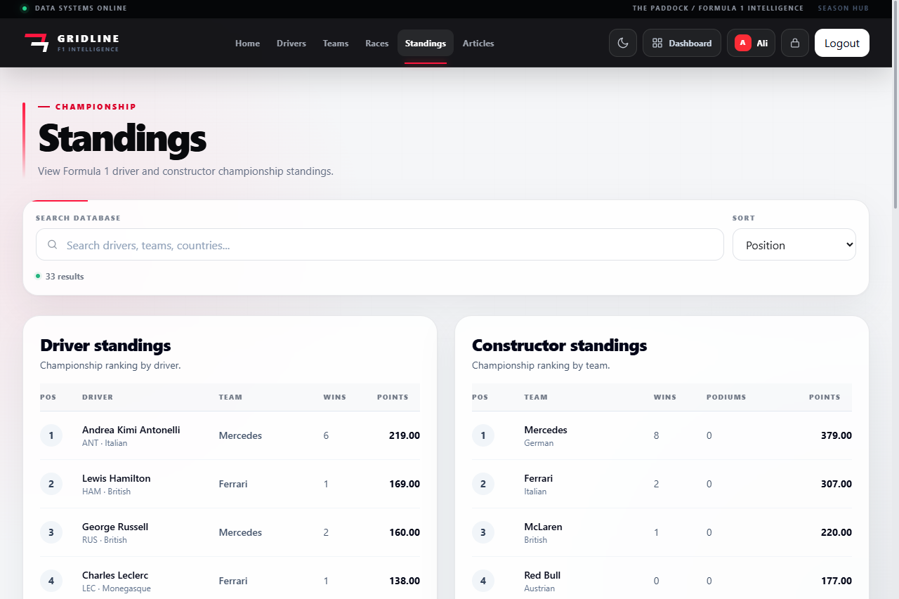
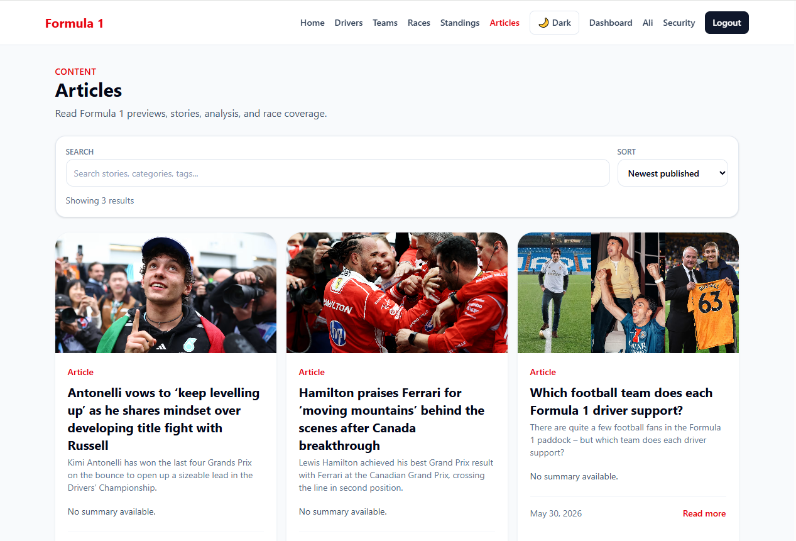

# Formula 1 — Frontend

A Formula 1 web application built with **React and TypeScript**. Explore drivers, teams, race results, championship standings, and articles, manage personal favorites, and ask questions through the **F1 AI Analyst**.

This repository contains the frontend. The Django REST API is available in the [backend repository](https://github.com/ali-mogharrab/f1-api-backend).

## Features

- **Races:** Season calendar, race details, qualifying and sprint results.
- **Drivers and teams:** Searchable listings, profile pages, and favorites.
- **Standings:** Driver and constructor championship standings by season.
- **Articles:** Featured stories, article listings, and individual article pages.
- **Accounts:** Registration, login, profile management, password reset, and a personalized dashboard.
- **F1 AI Analyst:** A chat interface with saved conversations and links to supporting sources.
- **User interface:** Responsive layouts, light and dark themes, and reusable loading and error states.

## F1 AI Analyst

The AI Analyst lets users explore Formula 1 data by asking questions in natural language. Its Django backend integrates the **OpenAI Responses API** and combines two approaches:

- **Function calling** retrieves structured racing data, including race results, driver performance, and championship standings, through validated Django tools.
- **Retrieval-Augmented Generation (RAG)** searches published articles using text embeddings and vector similarity to provide relevant context for answers.

The assistant can combine statistics and article content in the same conversation and return references to the sources used. The frontend includes an authenticated `/ai-analyst` page, conversation history, suggested questions, and clickable citations.

An **offline demo** is also available for exploring the chat experience with sample data and predefined responses, without an OpenAI API key.

## Screenshots

### Home


### Drivers


### Driver Details



### Teams



### Races



### Standings



### Articles



### User Dashboard


## Tech Stack

**React · TypeScript · Vite · Tailwind CSS · React Router · TanStack Query · Axios**

The frontend communicates with the Django REST API and uses JWT authentication with automatic access-token refresh.

## Getting Started

Requires **Node.js 22.12+** and a running [backend API](https://github.com/ali-mogharrab/f1-api-backend).

```bash
npm ci
cp .env.example .env
npm run dev
```

The `.env` file should point to the backend:

```env
VITE_API_BASE_URL=http://127.0.0.1:8000/api
```

Open the local address provided by Vite. Sign in to use `/ai-analyst`. To try the offline AI demo, start the backend with its demo settings first.

## Testing

```bash
npm run typecheck
npm run lint
npm run build
npx playwright install chromium
npm test
```

GitHub Actions runs frontend checks and browser tests. The project also includes `npm run test:demo` for a separate full-stack test against the local Django offline demo backend.
