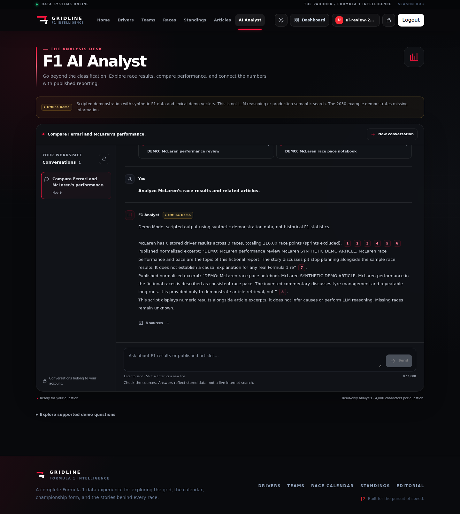
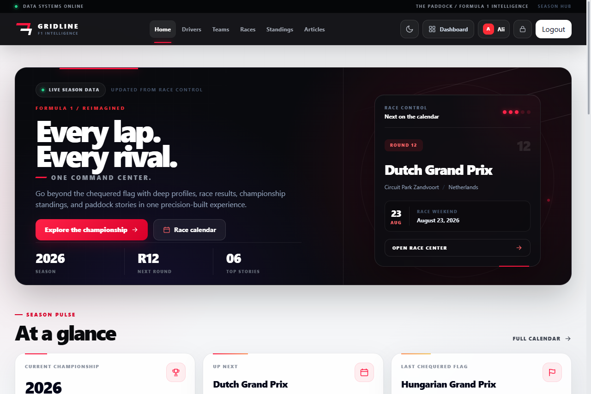
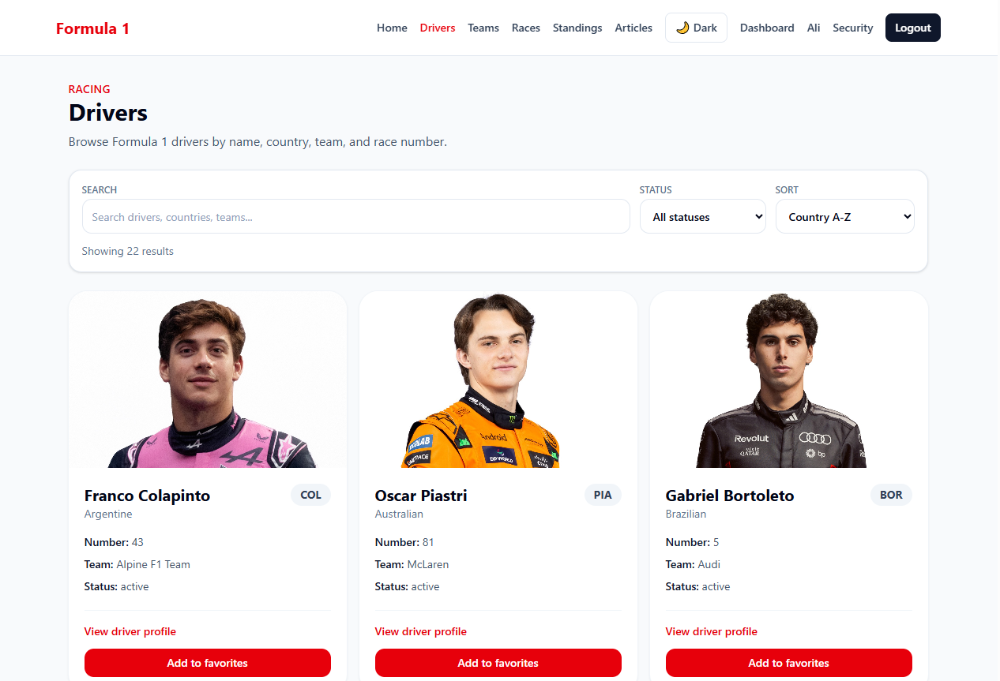
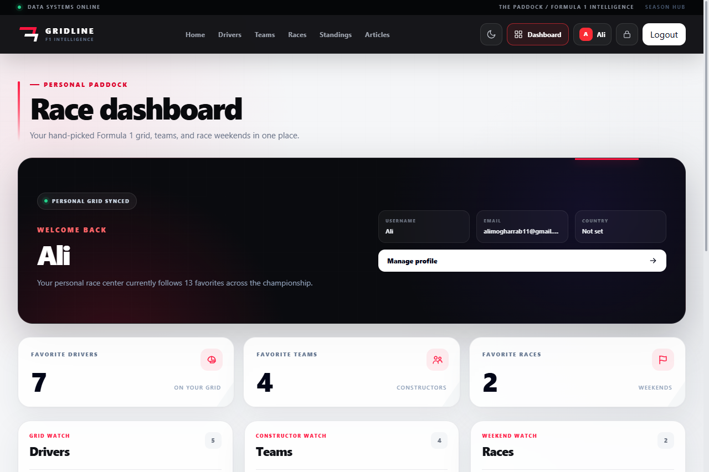

# Formula 1 Frontend

A React and TypeScript frontend for a Formula 1 web application. The project brings together racing data, season context, standings, editorial content, and user-specific favorites in one responsive interface.

This repository contains the frontend application. It is designed to consume a Django REST Framework API for racing data, content, authentication, profiles, and favorites.

## Overview

The app is built for Formula 1 fans who want a clean way to explore the sport beyond a single race weekend. It includes pages for drivers, teams, races, standings, and articles, plus account features that let authenticated users save their favorite drivers, teams, and races.

The home page highlights the current season, upcoming race, latest completed race, and featured articles. List pages include search, filtering, sorting, and pagination so users can quickly move through the available F1 data.

## Features

- Formula 1 home dashboard with current season, upcoming race, latest race, and featured articles
- Driver directory with search, status filtering, sorting, profile pages, and favorites
- Team directory with team detail pages and favorite support
- Race calendar with race detail pages and favorite support
- Driver and constructor standings pages
- Articles section with featured articles, article lists, and slug-based article detail pages
- User registration, login, logout, password reset, and password change flows
- Protected dashboard with recent favorite drivers, teams, and races
- Editable user profile
- JWT authentication with automatic access-token refresh
- Responsive layout with light and dark theme support
- Shared loading, error, empty-state, image fallback, and list-control components
- Protected F1 AI Analyst with persisted conversations, verified citations, and optional offline-demo metadata

## Tech Stack

- React
- TypeScript
- Vite
- Tailwind CSS
- React Router
- TanStack Query
- Axios
- Django REST Framework API integration

## Screenshots

### F1 AI Analyst — Offline Demo

Captured against the real local Django offline backend. All displayed race data
and reporting are synthetic; the mode indicator comes from response metadata.




### Home Page



### Drivers Page



### Driver Detail Page


### Teams Page


### Races Page


### Standings Page


### Articles Page


### Dashboard Page



## Main Pages

```txt
/                         Home
/drivers                  Driver list
/drivers/:id              Driver details
/teams                    Team list
/teams/:id                Team details
/races                    Race list
/races/:id                Race details
/standings                Driver and constructor standings
/articles                 Article list
/articles/:slug           Article details
/login                    Login
/register                 Register
/forgot-password          Request password reset
/reset-password-confirm   Confirm password reset
/dashboard                Protected user dashboard
/profile                  Protected profile page
/change-password          Protected password change page
/ai-analyst               Protected F1 AI Analyst workspace
```

## Project Structure

```txt
src/
├── api/          API clients for racing, content, standings, and auth
├── components/   Shared layout and reusable UI components
├── context/      Auth and theme providers
├── hooks/        AI conversation/query/mutation state
├── pages/        Route-level React pages
├── router/       App routes and protected route handling
├── types/        TypeScript models for API data
├── utils/        Token, theme, media, and API error helpers
├── App.tsx
├── main.tsx
└── index.css
```

## API

The frontend expects a Django REST Framework backend and reads the API base URL from:

```env
VITE_API_BASE_URL=http://127.0.0.1:8000/api
```

The API provides the app's Formula 1 data, article content, user authentication, profiles, and favorite resources. The Axios client attaches JWT access tokens to authenticated requests and refreshes expired access tokens when possible.

## Getting Started

Install dependencies:

```bash
npm install
```

Use Node.js 22.12+ (CI uses Node 24). Prefer `npm ci` for reproducible installs
from the checked-in lockfile. Never place an OpenAI key in a `VITE_*` variable.

Create an environment file:

```bash
cp .env.example .env
```

Start the app:

```bash
npm run dev
```

## Available Scripts

```bash
npm run dev
```

Runs the app locally with Vite.

```bash
npm run build
```

Type-checks the project and creates a production build.

```bash
npm run preview
```

Previews the production build locally.

```bash
npm run lint
```

Runs ESLint across the project.

## F1 AI Analyst

`/ai-analyst` integrates the Django assistant through the existing Axios client,
JWT refresh interceptor, protected routes, and TanStack Query. All assistant
answers come from Django. React contains example questions, presentation, and
error/recovery logic; it contains no scripted or hardcoded assistant answers.

The workspace includes an accessible composer (Enter sends, Shift+Enter inserts
a newline, with IME composition respected), a 4,000-character limit, pending and
failure states, paginated account-owned conversation history, deep links using
`?conversation=<UUID>`, and a New conversation action. Desktop, tablet, and mobile
layouts use the site's existing colors and light/dark theme. On mobile, History
opens a collapsible panel. New messages follow the viewport only when the reader
is near the bottom; a Latest messages control returns to the newest content.

### Start the complete offline demo

In a terminal opened in `f1-api-backend`, with its dependencies installed:

```bash
# Run from f1-api-backend; activate your virtual environment.
source .venv/bin/activate
export DEBUG=True
export DJANGO_SETTINGS_MODULE=config.settings.demo
python manage.py setup_ai_demo
# First launch only: choose your own local password.
python manage.py createsuperuser --username demo --email demo@example.com
python manage.py runserver 127.0.0.1:8000
```

These commands use `.venv` as the example environment. For a fresh backend
checkout, run `python3 -m venv .venv`, `source .venv/bin/activate`, and
`pip install -r requirements/development.txt` first, then use that environment for
the same management commands. Dependency installation may require a package index;
the running offline demo does not use external AI services.

This uses a separate synthetic SQLite database, never the ordinary development
database. See the backend's `docs/ai-analyst.md` for setup safety and provider
details. An ordinary registered user also works; administrator rights are not
required for chat. There are no built-in frontend credentials.

In a frontend terminal:

```bash
# Run from f1-frontend.
npm ci
# For a fresh checkout only; preserve an existing .env with custom configuration.
cp -n .env.example .env
npm run dev -- --host 127.0.0.1 --port 5173
```

The API base must include `/api`, without an extra `/ai` suffix:

```env
VITE_API_BASE_URL=http://127.0.0.1:8000/api
```

Open `http://127.0.0.1:5173/ai-analyst`, sign in with the local account, and try:

- `Compare Ferrari and McLaren's performance.`
- `What do the articles say about Ferrari?`
- `What do the articles say about McLaren?`
- `Analyze McLaren's race results and related articles.`
- `Who won the 2030 championship?`

Selecting a question fills the composer; it does not submit automatically. The
2030 example exercises missing information in the supplied dataset. Unsupported
questions also receive the backend's insufficient-evidence response. Every seeded
statistic/article is fictional demonstration data, not verified F1 history.

### Mode detection and real providers

The UI checks the returned `metadata.demo === true` or `metadata.mode === "demo"`
on chat answers and saved assistant messages. Only confirmed demo metadata shows
the Offline Demo badge and synthetic-data explanation. Before the first answer,
or when metadata is absent, the page stays neutral and labels its suggestions as
demo-compatible examples. There is no public mode-discovery endpoint, so mode is
not guessed from a hostname, environment flag, question, or answer text.

Saved demo messages remain labeled when reopened. The top notice reflects the
selected conversation's latest assistant metadata, not a promise about a future
deployment's provider. The demo uses scripted generation and deterministic lexical
vectors: it does not demonstrate genuine LLM reasoning or production semantic
search quality. Missing-evidence responses still show mode metadata when supplied.

To use the real OpenAI provider later, configure/run the backend in its normal
development or production settings and index articles with real embeddings. Keep
the same endpoints and `VITE_API_BASE_URL`. No React code or frontend API secret
is needed. Live model quality and availability must be evaluated separately.

### API, conversations, citations, and retries

`src/api/aiApi.ts` implements the actual contracts:

- `POST /ai/chat/`: `{message, conversation_id?}`; unwraps
  `{success,message,data:{conversation_id,answer,sources,metadata}}`.
- `GET /ai/conversations/`: paginated `{count,next,previous,results}` without a
  success envelope. Pages are requested numerically, not by following arbitrary
  returned URLs.
- `GET /ai/conversations/<id>/`: unwraps a success envelope containing ordered
  messages with role, content, sources, metadata, sequence, and timestamps.

Cache keys contain the authenticated user ID. Logout clears account data, queries
consume abort signals, and late mutation responses are ignored after unmount.
Concurrent 401 responses share a single token refresh. Requests and responses are
bound to their originating account session, so a late refresh cannot restore a
logged-out account or replay a request under a different account. Public login and
password-reset calls do not attach stale access tokens or trigger refresh loops.
Password changes return to login because the backend revokes the old session.
Conversation navigation, including browser Back/Forward, clears the previous
conversation's draft/error state. A new conversation has no inherited demo badge.
Conversation ownership is enforced by Django; unavailable/not-owned UUIDs do not
reveal another user's data. A fresh canonical GET replaces local message IDs after
each confirmed answer, avoiding duplicate display or persistence. No chat content
is written to browser localStorage. Protected-route login returns to the analyst.

Assistant text is rendered as escaped React text with preserved line breaks, not
raw HTML or interpreted Markdown links. Verified `[source_id]` markers become
numbered citation controls that open/focus their source cards. Unknown references
show an unavailable-source label. Article cards use validated slugs and the real
`/articles/:slug` route. Standing records link to `/standings`. Race-result source
UUIDs identify result records, not race entities; because the response lacks a race
ID and there is no result-detail frontend route, those cards display their title
without inventing a race link. Arbitrary source/model URLs are never used.

Chat mutations use `retry: false` and a 120-second HTTP timeout, above the default
backend orchestration deadline. Only the existing JWT interceptor can replay a
401 rejection after refreshing authentication; that rejection occurs before chat
processing. Expired refresh credentials return to the existing login page.

400/429 and documented Django 503/504 rejections allow an **explicit** retry.
404 requires a new conversation; 409 requires reloading history or starting a new
one. Full 100-message conversations require a new chat. Rate-limit responses show
the wait when available. History requests have their own read-only retry controls.

Network errors, client timeouts, generic server failures, and gateway timeouts
without the Django rejection envelope have **uncertain delivery**: the request
may already have persisted. The UI blocks resending and offers Check saved messages.
For a known conversation it reconciles a matching saved user/assistant pair. For
a newly created conversation whose response/ID was lost, refresh/open the saved
history manually. If the server is still processing, review again later. Starting
a new conversation clears the draft and never replays it automatically. The
backend has no idempotency-key endpoint, so arbitrary user-initiated repeated
questions across tabs/clients cannot be made globally idempotent by React alone.
There is no streaming, cancellation of an in-flight server generation, conversation
deletion, or automatic POST retry. Navigation controls wait for a pending answer.

### Checks and browser tests

Playwright is a development-only dependency; the application adds no runtime
libraries for chat or Markdown. With dependencies installed:

```bash
npm run typecheck
npm run lint
npm run build
npm audit
npx playwright install --with-deps chromium
npm test
```

The default suite starts Vite on `127.0.0.1:4173` and uses isolated API fixtures,
not OpenAI or a backend service. It covers submission/duplicate prevention,
suggestion selection, message/citation safety, pagination/reopening, mode detection,
known/uncertain errors and recovery, auth/refresh, scrolling, and responsive themes.
Screenshots and failure traces are ignored under `test-results/`; neither test
fixtures nor recordings are used as production responses. A preinstalled compatible
Chromium can be selected with `PLAYWRIGHT_CHROMIUM_EXECUTABLE_PATH`.

To run the optional **real local offline full-stack test**, start an explicitly
configured offline backend in a separate database (the test creates a local account):

```bash
# Run from f1-api-backend; activate your virtual environment.
source .venv/bin/activate
export AI_DEMO_DB=/tmp/f1-frontend-review-demo.sqlite3
export DEBUG=False
export CORS_ALLOWED_ORIGINS=http://127.0.0.1:4173,http://127.0.0.1:5173
python manage.py setup_ai_demo --settings=config.settings.demo
python manage.py runserver 127.0.0.1:8001 --noreload --settings=config.settings.demo
```

Wait for Django to report that the server is listening, then run in the frontend terminal:

```bash
AI_TEST_API_URL=http://127.0.0.1:8001/api npm run test:demo
```

Use only an offline demo backend for this command. It registers a fresh account,
uses the actual login UI, submits all five supported questions plus an unsupported
one, follows an article citation, reloads stored history, verifies actual JWT
refresh, and captures desktop/mobile screenshots. There are no chat API mocks in
this test and no external AI calls. It leaves its test account/conversation only
in the separately chosen demo database. The live suite is excluded from `npm test`.
Browser snapshots verify layout behavior; human visual review and live-provider
evaluation are separate steps and should only be claimed when actually performed.

The lockfile includes compatible security updates. A temporary development-only
`minimatch` override pins 11.0.1 to address
[GHSA-g3hv-75wg-m249](https://github.com/isaacs/minimatch/security/advisories/GHSA-g3hv-75wg-m249)
while ESLint/TypeScript-ESLint still request affected versions. Lint, type checks,
builds, and browser tests must pass with that override. Remove it when upstream
dependencies select a patched version without it. The audit result is a dated
dependency check, not proof that every possible vulnerability is absent.

## Notes

This frontend is part of a larger Formula 1 application and is meant to work with a Django REST Framework backend. The focus of this repository is the user-facing React application.

The November 2026 full-stack review also adds independent pagination for standings
and race/qualifying/sprint tables, with regression coverage beyond the first 20
records. The detailed review, commands, and verification limits are recorded in the
backend's `docs/review-2026-11-11.md`.
